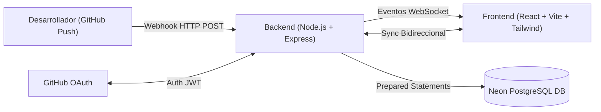

# ⚡ GitFlow (RepoSync / GitPulse)

> **Plataforma de Gestión Ágil y Telemetría de Código en Tiempo Real**  
> Unificando el esfuerzo de desarrollo en GitHub con la gestión de proyectos de alto impacto.

---

## 📌 ¿De qué trata el proyecto?

En el desarrollo de software tradicional existe una desconexión constante entre lo que ocurre en el repositorio de código y lo que refleja el tablero de tareas: los desarrolladores deben pausar su flujo de trabajo para actualizar manualmente tarjetas, reportar avances o registrar métricas. Esto genera información desactualizada, pérdida de tiempo y falta de visibilidad real sobre el avance de los sprints.

**GitFlow** resuelve este problema creando un ecosistema interactivo donde el código habla directamente con la gestión del proyecto:

1. **Autenticación Nativa con GitHub**: Inicio de sesión mediante OAuth 2.0 que identifica al integrante de forma instantánea, extrayendo su avatar, nombre de usuario y repositorios.
2. **Sincronización Autónoma por Webhooks**: Cada commit empujado a GitHub es interceptado en tiempo real. Mediante expresiones regulares (ej. `feat: login #12` o `fixes #5`), el commit se vincula a su tarea y actualiza su estado automáticamente en el tablero Kanban.
3. **Contexto Colaborativo en Vivo (Estilo Notion)**: Un editor Markdown compartido donde el equipo documenta decisiones técnicas y especificaciones. Gracias a WebSockets (**Socket.io**), es posible ver en vivo qué integrante está editando qué sección.
4. **Dashboard de Telemetría y Aportes**: Gráficos y tablas de impacto que cruzan commits con tareas cerradas, midiendo la velocidad del sprint y visibilizando el aporte real de cada miembro del equipo.

---

## 🏛️ Un poco de Arquitectura

GitFlow opera bajo una arquitectura desacoplada y orientada a eventos en tiempo real:



- **Frontend**: Desarrollado con React 18, Vite y Tailwind CSS bajo una interfaz oscura de estilo tecnológico (*Dark Tech UI*).
- **Backend**: Servidor Node.js con Express y Socket.io para comunicación bidireccional instantánea.
- **Base de Datos**: Neon Serverless PostgreSQL, blindada con **Prepared Statements** estrictos contra inyecciones SQL y dotada de un almacén en memoria para pruebas locales.
- **Despliegue**: Listo para producción en Vercel como monorepo (estáticos optimizados + Serverless Functions).

---

## 💻 ¿Cómo instalarlo y ejecutarlo en local?

### Requisitos Previos
- [Node.js](https://nodejs.org) versión 18 o superior.
- Git instalado en el equipo.

### Paso 1: Clonar el Repositorio
```bash
git clone https://github.com/edwin-esquivel-ADSO/GitFlow.git
cd GitFlow
```

### Paso 2: Instalar Dependencias
Desde la raíz del proyecto, ejecuta el siguiente comando para instalar todos los paquetes del frontend y del backend:
```bash
npm run install:all
```

### Paso 3: Variables de Entorno y Base de Datos (Neon)
El proyecto incluye un archivo de plantilla `.env.example`. Crea tu archivo local `.env`:
```bash
cp .env.example .env
```

> 💡 **Sobre Neon DB**:  
> No requieres una API Key fija para empezar a probar GitFlow. El backend cuenta con un **modo resiliente automático**: si aún no has configurado tu base de datos de Neon en `NEON_DB_URL`, el sistema arranca con datos de prueba precargados para que puedas probar el tablero Kanban, la edición colaborativa y la simulación de commits de inmediato.  
> Cuando desees conectar tu base de datos real, solo obtén la cadena de conexión en [neon.tech](https://neon.tech), colócala en `NEON_DB_URL` y ejecuta el script [`database/init-db.sql`](database/init-db.sql) en el SQL Editor de Neon.

### Paso 4: Iniciar el Proyecto (Frontend + Backend)
Inicia todo el entorno de desarrollo con **un solo comando**:
```bash
npm run dev
```

El sistema levantará:
- **Frontend**: [http://localhost:5173](http://localhost:5173)
- **Backend API & WebSockets**: [http://localhost:5000](http://localhost:5000)

---

## 📁 Documentación Técnica Avanzada

Todo el detalle técnico profundo, esquemas relacionales, configuración de webhooks y diagramas se encuentra organizado en la carpeta [`docs/`](docs/):

- 📘 [**Manual Técnico Detallado (`docs/manual-tecnico.md`)**](docs/manual-tecnico.md): Configuración de Neon DB, flujo OAuth, especificación de endpoints REST, eventos de WebSockets y guía de despliegue en Vercel.
- 📐 [**Diagramas de Arquitectura y Secuencia (`docs/architecture.md`)**](docs/architecture.md): Diagramas de flujo de datos, modelo Entidad-Relación (ERD) y secuencias paso a paso de los Webhooks y el editor colaborativo.
- 🗄️ [**Esquema de Base de Datos DDL (`database/init-db.sql`)**](database/init-db.sql): Script completo de creación de tablas, llaves foráneas, índices y datos semilla iniciales.

---

## 👥 Matriz de Roles - Equipo OMNICODE

| Rol OMNICODE | Responsabilidad | Integrante |
|---|---|---|
| **A00 - Orquestador** | Coordinación, gobernanza del proyecto y arquitectura global | **OMNICODE Core** |
| **A03 / A05 - Product Owner & UX** | Solidificación de la idea, diseño de flujos y experiencia de usuario *Dark Tech* | **OMNICODE UX Team** |
| **A06 / A10 - Arquitecto & DBA** | Diseño de base de datos Neon PostgreSQL y protocolos reactivos WebSockets | **OMNICODE Architecture** |
| **Desarrollador / Lead Full-Stack** | **Construcción integral del software, frontend, backend, APIs, WebSockets y despliegue** | **Edwin Esquivel** ([@edwin-esquivel-ADSO](https://github.com/edwin-esquivel-ADSO)) |
