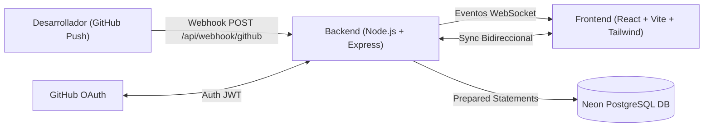

# ⚡ GitFlow (RepoSync / GitPulse) v2.0

> **Plataforma de Gestión Ágil, Telemetría en Tiempo Real y Salas Colaborativas**  
> Unificando el esfuerzo de desarrollo en GitHub con la gestión de proyectos de alto impacto.

---

## 📌 ¿De qué trata el proyecto?

En el desarrollo de software moderno existe una brecha constante entre lo que ocurre en el repositorio de código y el estado de las tareas: los desarrolladores deben pausar su flujo técnico para actualizar tarjetas, reportar avances y cuadrar métricas a mano.

**GitFlow** transforma esta dinámica convirtiendo el código en el motor autónomo de la gestión del proyecto:

1. **Salas de Trabajo Seguras con Código Dinámico (5 Minutos)**:
   - Cualquier desarrollador puede crear una **Sala (Proyecto)** o unirse a una existente.
   - Cada sala cuenta con un **código temporal de 6 caracteres que rota automáticamente cada 5 minutos**, garantizando máxima seguridad en el acceso del equipo.
2. **Privacidad de Tareas y Roles Inteligentes**:
   - **Vista de Creador (Admin)**: Visualiza el avance global, todas las tareas del equipo y métricas de velocidad.
   - **Vista de Miembros**: Cada integrante cuenta con un tablero enfocado exclusivamente en **sus tareas personales**, evitando distracciones.
3. **Flujo Ágil y Archivo en Historial**:
   - Las tareas avanzan por `Por Hacer` ➔ `En Progreso` ➔ `En Revisión` ➔ `Terminada`.
   - Al marcar una tarea como **Terminada**, esta se traslada a un **Historial Dedicado** que alimenta el perfil y las métricas de impacto de cada persona.
4. **Repositorio de Documentos & Contexto por Carpetas**:
   - Espacio fijo para consultar y editar la documentación técnica del proyecto.
   - Soporte organizado en carpetas (*Arquitectura*, *Diseño & UX*, *Reuniones*): notas Markdown (`.md`), documentos Word (`.docx`), guías PDF (`.pdf`) e imágenes/mockups (`.png`, `.jpg`).
5. **Autenticación y Telemetría Autónoma con GitHub**:
   - Inicio de sesión con GitHub OAuth.
   - Vinculación instantánea mediante Webhooks: al hacer `git push` con tags como `feat: auth #3` o `fixes #3`, el commit se asocia a la tarea y actualiza su estado en tiempo real.
6. **Interfaz Adaptativa (Dark / Light) & Navegación Móvil Estilo TikTok**:
   - Soporte fluido para **modo Claro y modo Oscuro** con persistencia local.
   - En **PC / Desktop**: Barra lateral izquierda fija (*Left Sidebar*) con acceso directo a todos los apartados.
   - En **Móviles**: Barra inferior táctil estilo TikTok con botón central de acción rápida.

---

## 🏛️ Un poco de Arquitectura

GitFlow opera con una arquitectura orientada a eventos en tiempo real:



- **Frontend**: React 18, Vite 5, Tailwind CSS con selector de temas claro/oscuro y componentes modulares.
- **Backend**: Express + Socket.io con salas por proyecto (`project_{id}`), control de presencia y generador de códigos de seguridad de 5 minutos.
- **Base de Datos**: Neon Serverless PostgreSQL, blindada con **Prepared Statements** estrictos y modo de prueba en memoria con seed data precargada.
- **Despliegue**: Listo para Vercel como Monorepo con Serverless Functions.

---

## 💻 ¿Cómo instalarlo y ejecutarlo en local?

### Requisitos Previos
- [Node.js](https://nodejs.org) versión 18 o superior.
- Git instalado.

### Paso 1: Clonar el Repositorio
```bash
git clone https://github.com/edwin-esquivel-ADSO/GitFlow.git
cd GitFlow
```

### Paso 2: Instalar Dependencias
Instala todos los paquetes del monorepo (frontend, backend y orquestador) con un solo comando:
```bash
npm run install:all
```

### Paso 3: Variables de Entorno
Copia la plantilla `.env.example` a `.env`:
```bash
cp .env.example .env
```

> 💡 **Nota sobre Neon DB**:  
> No necesitas configurar una base de datos externa para comenzar a probar GitFlow hoy. El backend incluye un **modo resiliente en memoria**: si `NEON_DB_URL` no está configurada, el sistema arranca con datos de prueba realistas para que explores las salas, el Kanban, el historial y los documentos inmediatamente.

### Paso 4: Iniciar la Plataforma
Inicia el backend y el frontend con **un solo comando**:
```bash
npm run dev
```

* **Frontend**: [http://localhost:5173](http://localhost:5173)
* **Backend API & WebSockets**: [http://localhost:5000](http://localhost:5000)

---

## 🔗 ¿Cómo vincular GitHub correctamente? (Paso a Paso)

### 1. Crear la GitHub OAuth App
1. Entra a tu cuenta en [GitHub Developer Settings > OAuth Apps](https://github.com/settings/developers).
2. Haz clic en **New OAuth App**:
   - **Application name**: `GitFlow Local`
   - **Homepage URL**: `http://localhost:5173`
   - **Authorization callback URL**: `http://localhost:5000/api/auth/github/callback`
3. Copia el **Client ID** y genera un **Client Secret**.
4. Pégalos en tu archivo `.env`:
   ```env
   GITHUB_CLIENT_ID=tu_client_id_aqui
   GITHUB_CLIENT_SECRET=tu_client_secret_aqui
   ```

### 2. ¿Cómo funciona la autenticación internamente?
- Al hacer clic en **"Iniciar sesión con GitHub"**, se solicita autorización con los scopes `read:user user:email repo`.
- GitHub redirige al callback con un código temporal que el backend intercambia por un token de acceso seguro.
- El backend consulta el perfil del desarrollador (`https://api.github.com/user`) y realiza un **Upsert con Prepared Statements** en la tabla `users`.
- Se emite un JSON Web Token (JWT) firmado con expiración de 7 días, permitiendo persistir la sesión.

### 3. Configurar Webhooks de Commits en tu Repositorio
1. En tu repositorio en GitHub, ve a **Settings > Webhooks > Add webhook**.
2. **Payload URL**: `https://tu-dominio-o-ngrok.com/api/webhook/github` (o usa el botón **"Simular Push"** en local).
3. **Content type**: `application/json`.
4. Eventos: **Just the push event**.
5. ¡Listo! Cada commit con `#ID` (ej. `feat: diseño #4`) se vinculará a la tarea #4 y emitirá telemetría en tiempo real por WebSockets a toda la sala.

---

## 📁 Documentación Técnica Avanzada

Todo el detalle técnico profundo se encuentra en la carpeta [`docs/`](docs/):

- 📘 [**Manual Técnico Detallado (`docs/manual-tecnico.md`)**](docs/manual-tecnico.md): Protocolos de seguridad, rotación de códigos de 5 minutos, especificación de endpoints REST y eventos Socket.io.
- 📐 [**Diagramas de Arquitectura y Secuencia (`docs/architecture.md`)**](docs/architecture.md): Diagramas de flujo Mermaid, modelo relacional ERD y flujos de datos.
- 🗄️ [**Esquema de Base de Datos DDL (`database/init-db.sql`)**](database/init-db.sql): Script completo de PostgreSQL con tablas, llaves foráneas, índices y seed data.

---

## 👥 Matriz de Roles - Equipo OMNICODE

| Rol OMNICODE | Responsabilidad | Integrante |
|---|---|---|
| **A00 - Orquestador** | Coordinación, gobernanza del proyecto y arquitectura global | **OMNICODE Core** |
| **A03 / A05 - Product Owner & UX** | Solidificación de la idea, diseño de interfaz adaptativa (Dark/Light) y navegación móvil TikTok-style | **OMNICODE UX Team** |
| **A06 / A10 - Arquitecto & DBA** | Diseño de base de datos Neon PostgreSQL, salas con códigos dinámicos y protocolos reactivos WebSockets | **OMNICODE Architecture** |
| **Desarrollador / Lead Full-Stack** | **Construcción integral de frontend, backend, APIs, WebSockets, seguridad y despliegue** | **Edwin Esquivel** ([@edwin-esquivel-ADSO](https://github.com/edwin-esquivel-ADSO)) |
