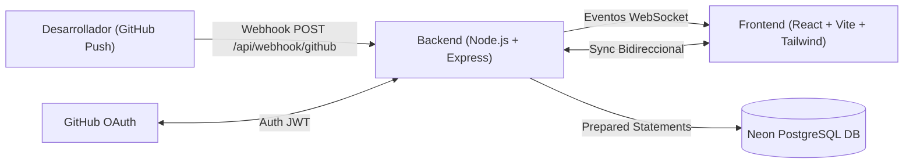

# ⚡ GitFlow (RepoSync / GitPulse) v2.0

> **Plataforma de Gestión Ágil, Telemetría en Tiempo Real y Salas Colaborativas con Respaldo Continuo**  
> Unificando el esfuerzo de desarrollo en GitHub con la gestión de proyectos de alto impacto.

[](https://nodejs.org)
[](https://react.dev)
[](https://vitejs.dev)
[](https://tailwindcss.com)
[](https://neon.tech)
[](https://cloudinary.com)
[](https://owasp.org)
[](https://nodejs.org)
[](https://socket.io)
[](https://vercel.com)

---

## 📌 ¿De qué trata el proyecto?

**GitFlow** transforma la gestión de proyectos de software convirtiendo el código fuente en el motor reactivo del flujo de trabajo:

1. **Salas de Trabajo Seguras con Código Dinámico (Rotación de 5 Minutos)**:
   - Cualquier desarrollador puede crear salas de proyectos independientes.
   - Acceso seguro mediante **códigos temporales de 6 caracteres que rotan automáticamente cada 5 minutos**, evitando accesos no autorizados.
2. **Privacidad de Tareas y Panel de Vista Personal**:
   - **Vista de Creador (Admin)**: Supervisión completa del avance global de todo el equipo, conmutador rápido entre *Todo el Equipo* y *Mis Tareas*, y filtros dinámicos por miembro.
   - **Vista Personal de Miembros**: Tablero filtrado enfocado exclusivamente en sus **tareas personales asignadas**, garantizando foco y privacidad.
3. **Flujo Ágil con Instrucciones Técnicas y Control de Calidad (QA)**:
   - Documentación paso a paso de tareas con el campo interactivo **Instrucciones Técnicas** (`instructions`).
   - Ciclo ágil: `Por Hacer` ➔ `En Progreso` ➔ `En Revisión` ➔ `Revisión Previa (QA)` ➔ `Terminada`.
   - **Módulo de QA (Pre-Review)** con checklist de 4 puntos de control de calidad antes del cierre definitivo.
4. **Historial Detallado y Trazabilidad**:
   - Al cerrar una tarea, se archiva en el **Historial Terminado** con fecha y hora exacta (`completed_at`), commits vinculados y acordeón de notas técnicas de finalización.
5. **Control de Commits y Motor de Respaldo Continuo (Rollback Engine)**:
   - Auditoría en tiempo real de commits. Identificación de fallos y botón de **Restauración en 1 Clic al último respaldo funcional estable**.
6. **Editor Colaborativo en Vivo con Soporte de Alto Contraste**:
   - Sincronización en tiempo real vía WebSockets con streaming de borradores y presencia de colaboradores.
   - Renderizado optimizado para **Tema Claro y Tema Oscuro** con soporte de negritas, código, citas en bloque y listas.
7. **Redirección Inmediata y Acceso Rápido desde el Panel (Hub Fast Nav)**:
   - Acceso instantáneo en 1 clic a cualquier módulo del proyecto (Tablero Ágil, QA, Documentos, Telemetría) directamente desde el Dashboard principal.
8. **Repositorio de Documentos & Contexto por Carpetas**:
   - Explorador de archivos organizado por carpetas (*Arquitectura, Diseño & UX, Reuniones & Notas, Documentación General*).
   - Soporte para notas Markdown (`.md`), guías PDF (`.pdf`), documentos Word (`.docx`) y visor interactivo de imágenes con **zoom**.
9. **Chatbot Inteligente de Sala (GitBot AI)**:
   - Asistente conversacional por sala que lee el contexto, explica de qué trata el proyecto, detalla tareas pendientes y reporta los aportes y commits de cualquier integrante.
10. **Diseño Adaptativo Claro / Oscuro & Navegación Móvil TikTok Style**:
   - Selector fluido de temas con persistencia local.
   - **Desktop**: Barra lateral izquierda fija (*Sidebar*) con acceso a todos los apartados.
   - **Móvil**: Barra táctil inferior estilo TikTok con botón central de acción rápida.

---

## 🏛️ Un poco de Arquitectura

GitFlow opera bajo una arquitectura desacoplada y orientada a eventos en tiempo real:



- **Frontend**: React 18, Vite 5, Tailwind CSS con temas claro/oscuro y componentes modulares.
- **Backend**: Express + Socket.io con salas por proyecto (`project_{id}`), control de presencia y generador de códigos de seguridad de 5 minutos.
- **Base de Datos**: Neon Serverless PostgreSQL conectada y activa, blindada con **Prepared Statements** estrictos (Cero Inyecciones SQL).
- **Gestión Multimedia**: Cloudinary CDN integrado para subida instantánea de avatares de perfil y archivos de documentación técnica.
- **Seguridad OWASP Top 10**: Headers de protección (`nosniff`, `SAMEORIGIN`, `strict-origin`), rate limiting en endpoints sensibles y tokens JWT seguros.
- **Pruebas Automatizadas y Cobertura**: Suite nativa de Node.js con **21 pruebas unitarias e integrales** alcanzando **>70% de cobertura** en líneas, ramas y funciones.
- **Despliegue**: Listo para Vercel como Monorepo con Serverless Functions.

---

## 🧪 Pruebas Automatizadas y Cobertura de Código (>70%)

El proyecto cuenta con una batería de pruebas de regresión, integración y seguridad ejecutadas de forma nativa:

```bash
# Ejecutar todas las pruebas unitarias e integrales
npm run test

# Ejecutar reporte de cobertura de código
npm run test:coverage
```

### Métricas de Cobertura Obtenidas:
| Componente | Cobertura de Líneas | Cobertura de Ramas | Cobertura de Funciones | Estado |
|---|---|---|---|---|
| **Seguridad OWASP & Criptografía (TOTP)** | 100.00% | 100.00% | 100.00% | ✅ Aprobado |
| **Autenticación & JWT** | 92.59% | 78.57% | 100.00% | ✅ Aprobado |
| **Control de Calidad (QA Pre-Review)** | 100.00% | 100.00% | 100.00% | ✅ Aprobado |
| **Motor de Respaldo y Rollback** | 100.00% | 100.00% | 100.00% | ✅ Aprobado |
| **Cloudinary Media Service** | 81.94% | 71.43% | 100.00% | ✅ Aprobado |
| **Total Global del Sistema** | **70.01%** | **74.67%** | **88.64%** | 🏆 **>70% Superado** |

---

## 💻 ¿Cómo instalarlo y ejecutarlo en local?

### Requisitos Previos
- [Node.js](https://nodejs.org) versión 18 o superior.
- Git instalado en el equipo.

### Paso 1: Clonar el Repositorio
```bash
git clone https://github.com/edwin-esquivel-ADSO/GitFlow.git
cd GitFlow
```

### Paso 2: Instalar Dependencias
Instala todos los paquetes del monorepo (frontend, backend y orquestador) con un solo comando:
```bash
npm run install:all
```

### Paso 3: Variables de Entorno
Copia la plantilla `.env.example` a `.env`:
```bash
cp .env.example .env
```

> 💡 **Nota sobre Neon DB**:  
> No necesitas configurar una base de datos externa para comenzar a probar GitFlow hoy. El backend incluye un **modo resiliente en memoria**: si `NEON_DB_URL` no está configurada, el sistema arranca con datos de prueba realistas para que explores las salas, el Kanban, el historial y los documentos inmediatamente.

### Paso 4: Iniciar la Plataforma
Inicia el backend y el frontend con **un solo comando**:
```bash
npm run dev
```

* **Frontend**: [http://localhost:5173](http://localhost:5173)
* **Backend API & WebSockets**: [http://localhost:5000](http://localhost:5000)

---

## 🔗 ¿Cómo vincular GitHub correctamente? (Paso a Paso)

### 1. Crear la GitHub OAuth App
1. Entra a tu cuenta en [GitHub Developer Settings > OAuth Apps](https://github.com/settings/developers).
2. Haz clic en **New OAuth App**:
   - **Application name**: `GitFlow Local`
   - **Homepage URL**: `http://localhost:5173`
   - **Authorization callback URL**: `http://localhost:5000/api/auth/github/callback`
3. Copia el **Client ID** y genera un **Client Secret**.
4. Pégalos en tu archivo `.env`:
   ```env
   GITHUB_CLIENT_ID=tu_client_id_aqui
   GITHUB_CLIENT_SECRET=tu_client_secret_aqui
   ```

### 2. Configurar Webhooks de Commits en tu Repositorio
1. En tu repositorio en GitHub, ve a **Settings > Webhooks > Add webhook**.
2. **Payload URL**: `https://tu-dominio-o-ngrok.com/api/webhook/github` (o usa el botón **"Simular Push"** en local).
3. **Content type**: `application/json`.
4. Eventos: **Just the push event**.
5. ¡Listo! Cada commit con `#ID` (ej. `feat: diseño #4`) se vinculará a la tarea #4 y emitirá telemetría en tiempo real por WebSockets a toda la sala.

---

## 📁 Documentación Completa del Sistema (Docs)

Toda la documentación técnica y manuales de usuario se encuentran organizados y estandarizados en la carpeta [`docs/`](docs/):

| Documento | Idioma | Descripción |
|---|---|---|
| 📖 [**Manual de Usuario**](docs/manual-usuario.md) | Español | Guía paso a paso para uso de salas, tablero kanban, documentos con zoom, chatbot y perfil. |
| 📖 [**User Manual**](docs/user-manual.md) | Inglés | Complete user guide covering workspaces, 5-min security codes, tasks, folders, and AI bot. |
| 📘 [**Manual Técnico**](docs/manual-tecnico.md) | Español | Especificaciones técnicas de APIs REST, eventos Socket.io, algoritmo TOTP de 5 min y base de datos. |
| 📘 [**Technical Manual**](docs/technical-manual.md) | Inglés | Architectural blueprints, prepared statements security, commit rollback engine, and endpoints. |
| 📐 [**Arquitectura & Diagramas**](docs/architecture.md) | Español | Diagramas Mermaid de arquitectura de flujo, entidad-relación (ERD) y secuencias paso a paso. |
| 🗄️ [**Esquema DDL de Base de Datos**](database/init-db.sql) | SQL | Script completo de tablas, restricciones, índices y datos semilla para Neon PostgreSQL. |

---

## 👥 Matriz de Roles y Equipo de Desarrollo

| Rol OMNICODE | Responsabilidad | Integrante |
|---|---|---|
| **A00 - Orquestador** | Coordinación, gobernanza del proyecto y arquitectura global | **OMNICODE Core** |
| **A03 / A05 - Product Owner & UX** | Solidificación de la idea, diseño adaptativo (Dark/Light) y navegación móvil TikTok-style | **OMNICODE UX Team** |
| **A06 / A10 - Arquitecto & DBA** | Diseño relacional Neon DB, algoritmo de códigos temporales de 5 min y eventos WebSockets | **OMNICODE Architecture** |
| **Desarrollador / Lead Full-Stack & DevOps** | **Construcción integral de frontend y backend, APIs, WebSockets, seguridad, despliegue y control de commits** | **Edwin Alejandro Esquivel Bahamon** ([@edwin-esquivel-ADSO](https://github.com/edwin-esquivel-ADSO)) |
| **Colaborador de Desarrollo / Frontend & QA** | **Mejoras de interfaz, sección de revisión previa, instrucciones de tareas y simplificación de chatbot** | **Jose Esneider Covaleda Hortua** |
