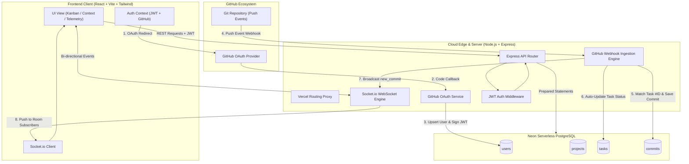
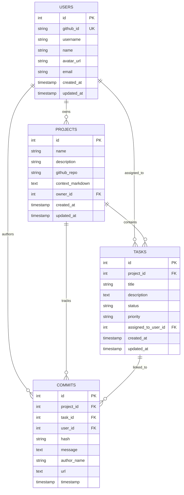
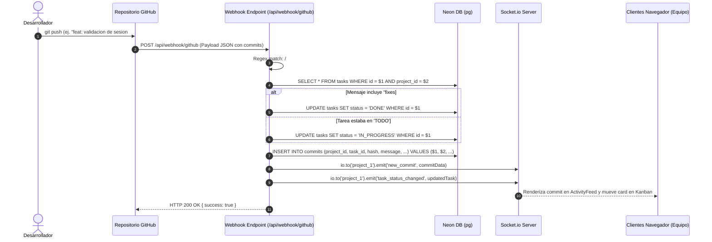
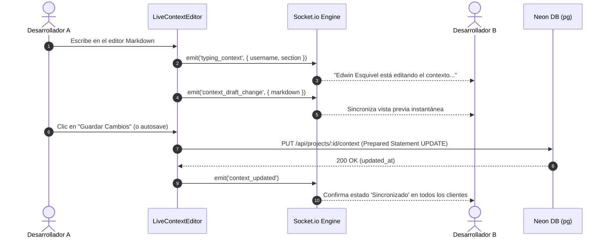

# 🏛️ GitFlow Architecture & Engineering Specification

## 1. Visión General del Sistema

**GitFlow** (RepoSync / GitPulse) es una plataforma de ingeniería full-stack diseñada para cerrar la brecha entre la gestión ágil de proyectos y la telemetría del código fuente en tiempo real. 

A diferencia de los gestores tradicionales desconectados del desarrollo, GitFlow reacciona instantáneamente a cada commit empujado a GitHub, analiza la intención técnica mediante expresiones regulares (ej. `#12`, `fixes #12`), actualiza el ciclo de vida de las tareas en un tablero Kanban reactivo y propaga los cambios a través de WebSockets sin requerir recargas de página.

---

## 2. Modelo de Datos y Esquema Relacional (ERD)

La base de datos está implementada sobre **Neon PostgreSQL**. Todas las operaciones de lectura y escritura utilizan consultas parametrizadas (**Prepared Statements**) mediante `$1, $2, ...` para garantizar una protección absoluta contra inyecciones SQL (SQL Injection).

---

## 3. Flujo de Telemetría: GitHub Webhook ➔ Vinculación ➔ WebSocket Push

---

## 4. Edición Colaborativa de Contexto (Live Markdown Notion-style)

---

## 5. Estrategia de Despliegue en Vercel (Monorepo)

- **Frontend Estático**: Compilado con Vite (`npm run build`), optimizado con Tailwind CSS, servido vía el CDN global de Vercel.
- **Backend Serverless / Node.js**: Las rutas bajo `/api/(.*)` son dirigidas a `backend/api/index.js`, que envuelve la aplicación Express.
- **Seguridad**:
  - Encabezados CORS restrictivos pero flexibles para previsualizaciones de Vercel.
  - Validación JWT en endpoints privados.
  - Parámetros SQL sanitizados al 100% mediante `pg.Pool.query(sql, [params])`.
